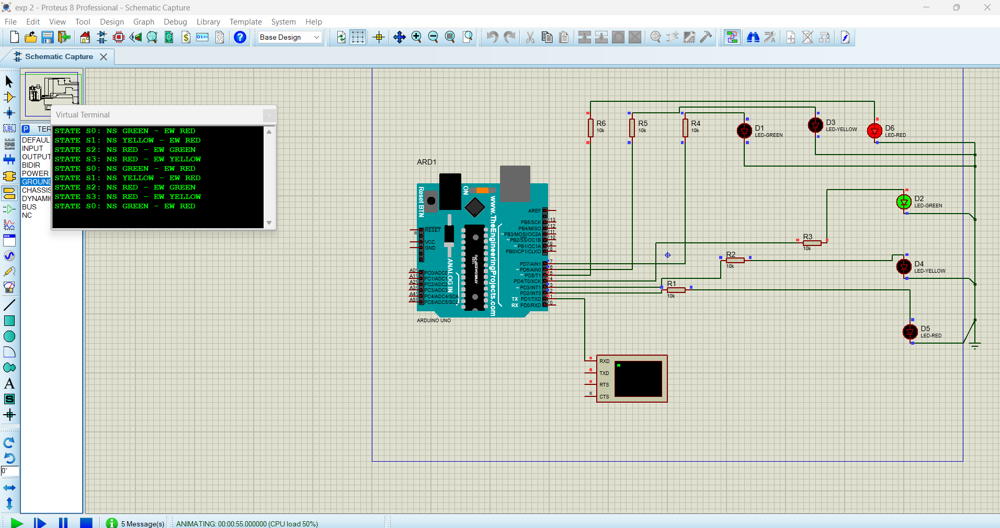
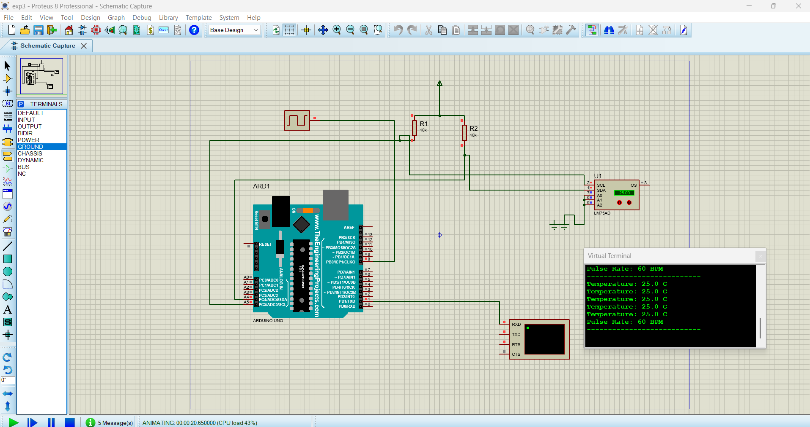
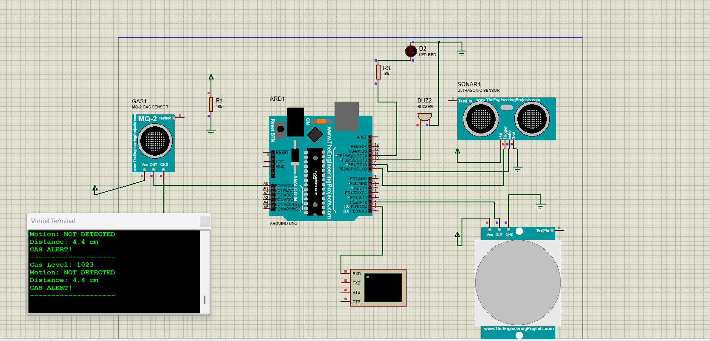
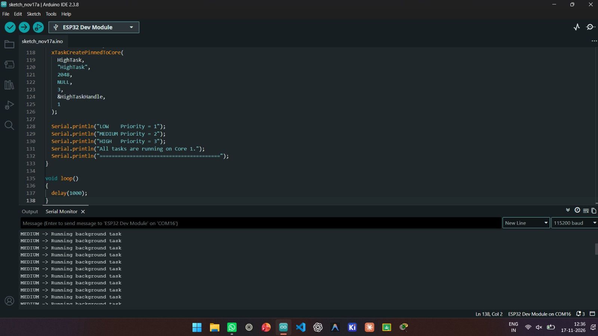
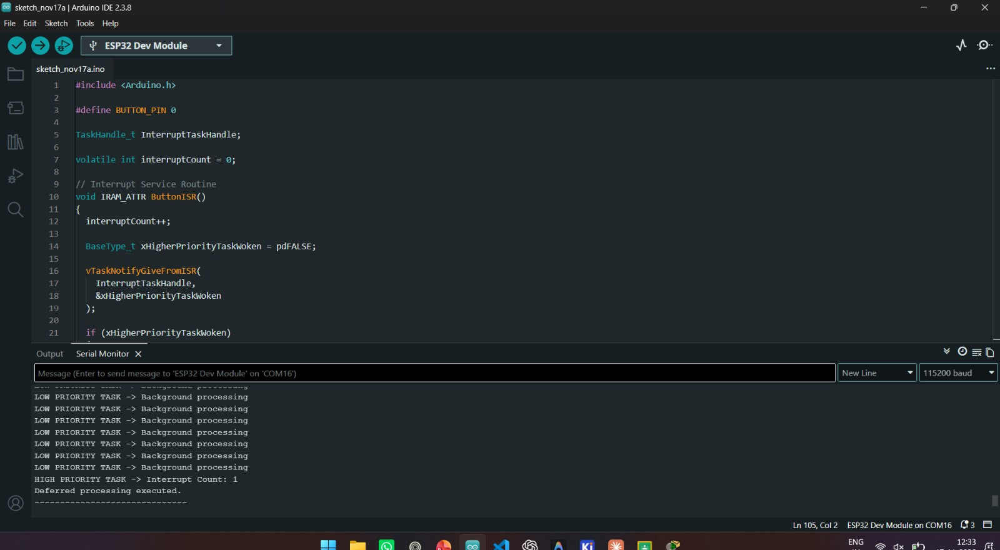
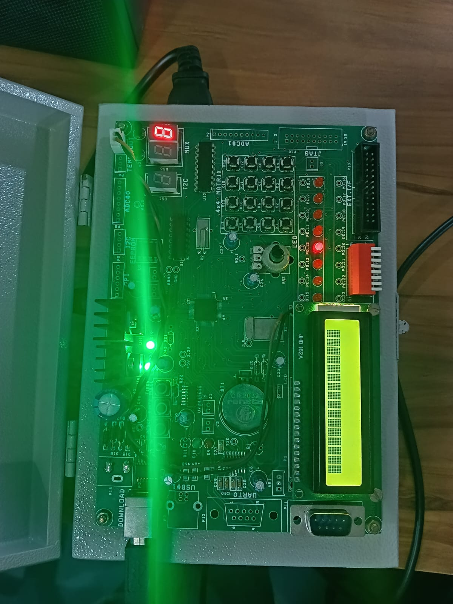

<div align="center">

# 🔌 ECA1418 – Embedded Systems Lab

**Code, simulations and results for every experiment, organised by platform.**


[Overview](#-overview) · [Structure](#-repository-structure) · [Experiments](#-experiments) · [Gallery](#-gallery) · [Run it](#-how-to-run) · [Status](#-status)

</div>

---

## 📖 Overview

This repository collects the lab work for the **ECA1418 Embedded Systems** course. It covers the full stack, from bare-metal 8051 assembly and ARM7 firmware to FreeRTOS on ESP32, plus Python host tooling and SystemC modelling.

| | |
|---|---|
| **Platforms** | 8051 · Arduino UNO · LPC2148 (ARM7) · ESP32 |
| **Tools** | Proteus · Keil µVision · Arduino IDE / PlatformIO · EDA Playground |
| **Languages** | Assembly · C/C++ · Python · SystemC |

## 🗂 Repository structure

```text
ECA1418_Embedded_System/
├── 8051-assembly/          # Port I/O labs in assembly (Proteus)
│   └── exp-1 … exp-4
├── arduino-proteus/        # Arduino UNO sketches + Proteus projects
│   ├── multi-sensor-alert/
│   ├── traffic-light-fsm/
│   └── lm75-pulse-monitor/
├── lpc2148-arm7/           # Keil µVision projects
│   ├── switch/
│   ├── seven-seg/
│   └── serial/
├── rtos-esp32/             # FreeRTOS on ESP32
│   └── exp-13 … exp-20
├── python-esp32-serial/    # Host script + ESP32 test sketch
└── eda-systemc/            # SystemC experiment reports (PDF)
```

## 🧪 Experiments

### 🔹 8051 Assembly → [`8051-assembly/`](8051-assembly)

| Experiment | Description | Files |
|---|---|---|
| [exp-1](8051-assembly/exp-1) | LED blink on P2.0 with a software delay loop | `code.asm` |
| [exp-2](8051-assembly/exp-2) | LED blink on P2.0 | `code.asm` |
| [exp-3](8051-assembly/exp-3) | Stepper motor drive sequence on P2 | `code.asm` |
| [exp-4](8051-assembly/exp-4) | 7-segment counter 0–9 on P2 | `code.asm`, `code-alt.asm` |

### 🔹 Arduino + Proteus → [`arduino-proteus/`](arduino-proteus)

| Project | Description | Key parts |
|---|---|---|
| [multi-sensor-alert](arduino-proteus/multi-sensor-alert) | Gas, PIR motion and ultrasonic readings trigger a buzzer and LED | Gas sensor, PIR, ultrasonic |
| [traffic-light-fsm](arduino-proteus/traffic-light-fsm) | Four-state traffic light controller built as an FSM | 6 LEDs |
| [lm75-pulse-monitor](arduino-proteus/lm75-pulse-monitor) | I²C temperature reading plus pulse/BPM counting | LM75, pulse input |

Each project contains the sketch, a `screenshot.png`, the Proteus design in `proteus/` and compiled output in `build/`.

### 🔹 LPC2148 (ARM7) → [`lpc2148-arm7/`](lpc2148-arm7)

| Project | Description |
|---|---|
| [switch](lpc2148-arm7/switch) | Reading a switch input |
| [seven-seg](lpc2148-arm7/seven-seg) | Driving a 7-segment display |
| [serial](lpc2148-arm7/serial) | UART communication with terminal output |

> ℹ️ These folders hold the Keil project (`.uvproj`) and generated `.hex`. The C sources are not in the repo yet.

### 🔹 FreeRTOS on ESP32 → [`rtos-esp32/`](rtos-esp32)

| Experiment | Concept | Files |
|---|---|---|
| [exp-13](rtos-esp32/exp-13-task-priorities) | Task priorities and scheduling | `main.cpp` |
| [exp-14](rtos-esp32/exp-14-semaphores-mutex) | Binary & counting semaphores, mutex | `binary_semaphore.cpp`, `counting_semaphore.cpp`, `mutex_counter.cpp` |
| [exp-15](rtos-esp32/exp-15-queue-mailbox-stream) | Queue, mailbox, stream buffer | `queue.cpp`, `mailbox.cpp`, `stream_buffer.cpp` |
| [exp-16](rtos-esp32/exp-16-timers-event-groups) | Software timers + event groups | `main.cpp` |
| [exp-17](rtos-esp32/exp-17-isr-task-notification) | Button ISR → task notification | `main.cpp` |
| [exp-19](rtos-esp32/exp-19-priority-inheritance) | Mutex priority inheritance | `main.cpp` |
| [exp-20](rtos-esp32/exp-20-memory-management) | Heap, stack high-water mark, memory pool | `main.cpp` |

### 🔹 Python ↔ ESP32 → [`python-esp32-serial/`](python-esp32-serial)

`esp32_test_signal.ino` prints `TEST_SIGNAL` every second at 115200 baud. `serial_test.py` reads it over `COM3` and counts passes.

### 🔹 SystemC → [`eda-systemc/`](eda-systemc)

| Report | Topic |
|---|---|
| [Experiment 10](eda-systemc/experiment-10-systemc-clock.pdf) | Clock generation simulation |
| [Experiment 11](eda-systemc/experiment-11-systemc-tlm.pdf) | TLM initiator–target transaction |

## 🖼 Gallery

<table>
  <tr>
    <td align="center"><br><sub>Traffic light FSM</sub></td>
    <td align="center"><br><sub>LM75 + pulse monitor</sub></td>
    <td align="center"><br><sub>Multi-sensor alert</sub></td>
  </tr>
  <tr>
    <td align="center"><br><sub>Priority inheritance output</sub></td>
    <td align="center"><br><sub>ISR task notification output</sub></td>
    <td align="center"><br><sub>LPC2148 seven-segment</sub></td>
  </tr>
</table>

## ▶️ How to run

<details>
<summary><b>8051 and Arduino (Proteus)</b></summary>

1. Open the `.pdsprj` file in Proteus.
2. Double-click the microcontroller and load the matching `.hex` (from `build/` for Arduino projects).
3. Press **Play** to start the simulation.

</details>

<details>
<summary><b>LPC2148 (Keil µVision)</b></summary>

1. Open the `.uvproj` in Keil µVision.
2. Add your C source to the project, then build.
3. Load the generated `.hex` in your simulator or flash tool.

</details>

<details>
<summary><b>ESP32 FreeRTOS experiments</b></summary>

1. Create a PlatformIO or Arduino IDE project for your ESP32 board.
2. Copy the experiment's `.cpp` into `src/main.cpp` (or paste it into a sketch).
3. Upload, then open the serial monitor at **115200 baud**.

Experiment 17 uses GPIO 0, the BOOT button on most ESP32 dev boards.

</details>

<details>
<summary><b>Python serial test</b></summary>

```bash
pip install pyserial
# edit the port in serial_test.py (default: COM3)
python serial_test.py
```

Upload `esp32_test_signal.ino` to the ESP32 first, and close the Arduino serial monitor so the port is free.

</details>

## ✅ Status

- [x] 8051 assembly: experiments 1–4
- [x] Arduino + Proteus: 3 projects
- [x] LPC2148: project files and outputs
- [ ] LPC2148: C source files
- [x] FreeRTOS: experiments 13–17, 19, 20
- [ ] FreeRTOS: experiment 18
- [x] SystemC: experiments 10–11

## 🙌 Credits

Some experiments were merged in from [Deepak192511008/ECA1418](https://github.com/Deepak192511008/ECA1418).
